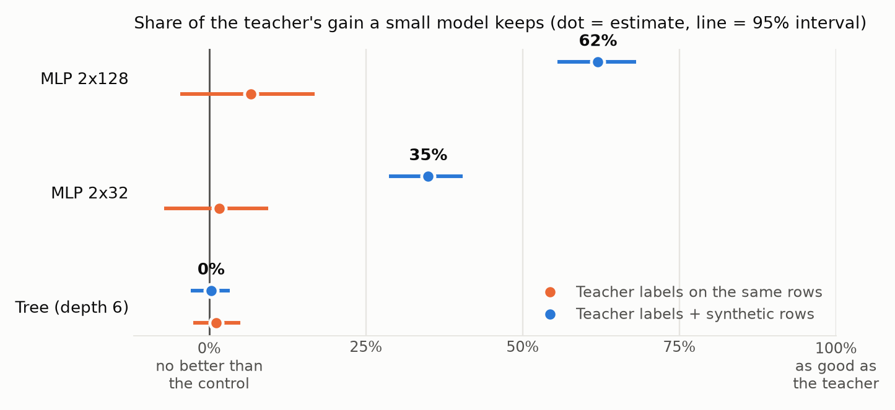
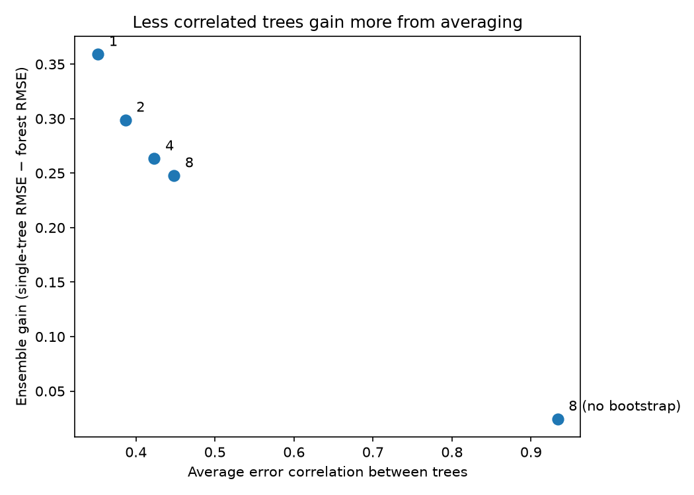

# Ensemble distillation: how much of a tree ensemble's gain can a small model keep?

A tree ensemble predicts well but costs far more compute than a small model. This project measures how much of the ensemble's accuracy advantage a small student keeps when it is trained from the ensemble, compared with the same student trained on the true labels, and what the student saves in size, speed and memory.

It is a measurement project on one dataset (California Housing: predict a block group's median house value from 8 numeric features), run on one machine (MacBook Pro, Apple M5 Pro, 64 GB).

**Result.** The best small model (an MLP with 2 hidden layers of 128) closes 62% of the gap between the same MLP trained on true labels and the teacher, at about 1/1,000 of the teacher's file size (0.42 MB against 418 MB).

## Headline



**Gain** is how much lower the teacher's test RMSE is than the same student trained on true labels. **Share kept** is how much of that gap the distilled student closes. The teacher's test RMSE is **0.458**.

| Student | RMSE, true labels (control) | RMSE, distilled (teacher labels + synthetic rows) | Share of the teacher's gain kept (95% interval) |
|---|---|---|---|
| MLP, 2 hidden layers of 128 | 0.520 | 0.482 | **62%** (56% to 68%) |
| MLP, 2 hidden layers of 32 | 0.533 | 0.507 | **35%** (29% to 40%) |
| Decision tree, depth 6 | 0.705 | 0.704 | none measurable |

RMSE is in units of $100k and is the mean over 5 seeds. Share kept = (control RMSE − distilled RMSE) ÷ (control RMSE − teacher RMSE), computed from unrounded values: (0.520 − 0.482) ÷ (0.520 − 0.458) is about 62%.

- **What works:** the student has to see the teacher's labels on many more inputs. The teacher's labels on the same training rows, without extra rows, do not help measurably: every interval includes zero.
- **The teacher is a strong tree model, not a better-than-its-parts ensemble.** It is an equal blend of a tuned LightGBM and a 300-tree random forest. It scores 0.458, slightly worse than LightGBM alone (0.441), because the two members' errors are 0.92 correlated. So the gain measured here is mostly the gap between a tree model and a small MLP on this dataset, not a benefit of blending. Distilling from LightGBM alone was not run.

### What the small models cost

| Model | Size on disk | Parameters | Single-row latency (p50) | Model-only (p50) | Batch throughput | Memory to load |
|---|---|---|---|---|---|---|
| Teacher (LightGBM + random forest) | 418 MB | 6.1M tree nodes | 5.5 ms | 5.5 ms | 31 thousand rows/s | 857 MB |
| MLP 2x128, distilled | 0.42 MB | 17,793 | 124 µs | 6 µs | 3.6 million rows/s | ~0.1 MB* |
| MLP 2x32, distilled | 0.04 MB | 1,377 | 123 µs | 5 µs | 13 million rows/s | ~0.1 MB* |
| Tree (depth 6), distilled | 0.01 MB | 127 | 23 µs | 1 µs | 122 million rows/s | ~0.1 MB* |

\* Memory to load is the growth in resident memory when the model file is loaded, measured to about 0.1 MB. The three small models sit at that floor even though their files range from 0.01 to 0.42 MB, so read it as "about 0.1 MB or less", not as a difference between them.

Latency, throughput and memory use one thread per model, measured on the machine above. For the small models most of the single-row time is Python and scikit-learn overhead, which is why the model-only column is shown.

**The teacher is not free.** It took about 10 minutes to build, 90% of that tuning LightGBM. If it has to be built just to train one student, a distilled MLP costs roughly 500 to 900 times what the control costs: about 619 seconds of teacher work plus 6 to 15 seconds of student training, against 0.7 to 1.3 seconds for the control. The saving shows up when the teacher already exists, or when predictions are served at volume.

## Why an ensemble helps at all

Twenty-one independent voters, each right 60% of the time, reach 83% by majority vote. Twenty-one identical copies of one voter stay at 60%. Random forests show the same thing: the less correlated the trees' mistakes, the more the forest gains over a single tree.



The same rule explains the teacher above: with errors correlated at 0.92, blending LightGBM and the forest gave no gain over LightGBM alone.

## Other measurements

- **Data.** The target is capped at $500k (4.9% of rows), some features have extreme values, and location matters. Neighboring blocks land in both train and test, so every score here is likely optimistic compared with predicting a new region.
- **LightGBM against an MLP at equal budget.** Each got 20 random-search trials scored by the same 5-fold CV. LightGBM reached test RMSE 0.441 (CV 0.449 ± 0.013) and the MLP 0.530 (CV 0.518 ± 0.017). That is what these two searches showed on this dataset, not a claim about trees and nets in general.
- **The teacher** beats the forest but not LightGBM alone (see the headline).

## How it was measured

- One frozen test set, never used to choose anything. Model selection by the same 5-fold CV for every model. Scalers are fit inside each training fold.
- The student's training labels come from out-of-fold teacher predictions, so the teacher never labels rows it trained on.
- Three arms per student: true labels (the control), teacher labels on the same rows, teacher labels plus synthetic rows. 3 students x 3 arms x 5 seeds = 45 fits.
- Intervals come from a paired bootstrap over the test rows (1,000 draws).
- Results reproduce bit for bit: re-running a seed gives identical predictions. Each model ships as one `joblib` file with a model card (git commit, date, test metrics, feature ranges, file hash), and a test reloads it in a fresh process and requires identical predictions. 34 tests in all.

## Reproduce

```
pip install -e ".[dev]"      # on macOS, LightGBM also needs: brew install libomp
./run_all.sh                 # searches, 45 distillation fits, artifacts, tests
```

The notebooks in `notebooks/` hold the analysis and rebuild the figures from `results/`. Decisions and changes are logged in `CHANGELOG.md`.

## Repo map

```
notebooks/   setup_baselines, error_correlation, lightgbm_vs_mlp, distillation,
             distillation_results, size_speed_memory, report_figures
src/         shared code, the searches, the distillation runs, memory measurement
tests/       metric parity, determinism, model save/load round trip, and more
results/     tables and figures written by the scripts
artifacts/   model cards (the saved models are rebuilt by run_all.sh)
```

## Data

California Housing, loaded with `sklearn.datasets.fetch_california_housing` (Pace and Barry, 1997; 1990 US census block groups).
